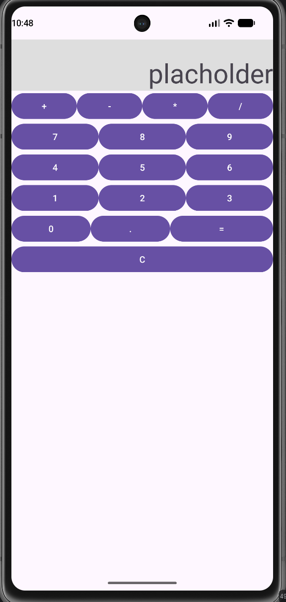

## Nazwa
kalkulator
## Zrzut ekranu

## Technologie
Java 17, Android SDK, midSdk 24, Empty Views Activity
## Funkcje
brak
## Autor
Fabian Ługowski 5P

ma dwa poziomy zagniezdzenia, bo pierwszy jest pionowy a drugi poziomy
ostatnie mają wage 1, 1 i 2 bo 2 to dwa razy wiecej niz 1
